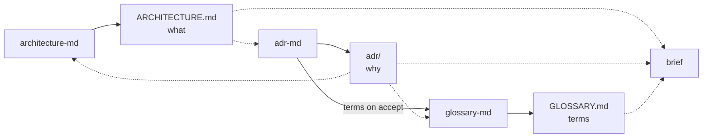

# architecture-skills

**Agent skills for Claude Code that keep what a codebase knows about itself in the repo: what the system is, why it is built that way, and what its terms mean.**

Claude Code plugin · Agent Skills format · MIT license · tested on Claude Code 2.1.325 with Opus 5.5 and Sonnet 5.5; Haiku 5.5 not supported

To answer a question about a codebase, an agent reads the code, and next session it reads it again: the same files, the same tokens, and an answer that is gone when the session ends. These skills write that understanding into `docs/` once, as markdown tied to files, lines and the commit it describes. People and agents start from the docs, open only the code they cite, and rerun a skill when the code changes.

## Uses

- **Talk to the codebase.** Ask how a flow works, why a choice was made, or what a term means, and get an answer from the docs and the code they cite. Reference `docs/ARCHITECTURE.md` from `CLAUDE.md` and sessions can start from it instead of exploring.
- **Understand an existing project.** Map an inherited or unfamiliar repo before changing it, and get an architect's brief in chat.
- **Review and harden.** The architecture doc covers auth, trust boundaries, secrets and a threat table (STRIDE on request). The brief adds an assessment with risks and open questions. The fixes you decide on become ADRs.
- **Plan work in other tools.** The docs are plain markdown, so an agent with a project-tracking plugin can turn the doc's gaps and open work, or the brief's risks, into issues.
- **Keep decisions and vocabulary.** Record why the team chose one option over the others, lock the record once accepted, and keep one definition per term.

## Skills

Each skill runs on its own. When the others' files exist, it reads them.

| Skill | Keeps | Does |
|---|---|---|
| `architecture-md` | `docs/ARCHITECTURE.md`: what the system is | Reads the code and documents components, C4 diagrams, data flows, security, configuration and data stores |
| `adr-md` | `docs/adr/`: why it is built that way | Records one decision per file, with the options considered and the consequences, and keeps statuses, supersession links and the index consistent |
| `glossary-md` | `docs/GLOSSARY.md`: what its terms mean | Keeps one definition and one source per term, taking new terms from each accepted ADR |
| `brief` | nothing, answers in chat | An architect's brief from the docs: a verdict, a diagram, one request traced end to end, where to start reading, and an assessment marked as opinion |



Solid arrows write, dotted arrows read. `architecture-md` links the key decisions it finds to their ADRs; `adr-md` checks a decision against the components it touches; `brief` uses ADRs to find the reason for a choice before criticizing it. Existing files are used where they are: an `ARCHITECTURE.md` at the root, a `TERMINOLOGY.md`, ADRs in `docs/decisions/` or `adr/`.

## Trust

- Every fact cites `path:line`, every inference starts with *Inferred:*, and missing evidence is a stated gap. Where a README or comment disagrees with the code, the doc follows the code and notes the conflict.
- Each doc records the commit it describes. A rerun of `architecture-md` rewrites only the sections whose code changed and keeps text between `<!-- keep -->` markers byte for byte; `brief` says how many commits the doc is behind.
- Accepted ADRs are locked. A change becomes a new record that supersedes the old one.

An excerpt from one eval run of `brief` on a small shop backend built for the tests. The full reply also has a parts table, a request traced end to end, and files to start reading.

> shopfront is the backend for a small online shop. ... In my view it's a sensible, small design with one good key decision (capturing payments off the request path). It isn't ready for real money yet: a retried capture can charge a customer twice, and nothing logs or alerts when a capture fails.

```
  +----------+  HTTPS   +---------+   SQL    +---------------+
  | Customer |--------->|   api   |--------->|  PostgreSQL   |
  +----------+          +---------+          | products,     |
                             |               | users, orders |
                             | enqueue job   +---------------+
                             v                      ^
                        +---------+   dequeue  +--------+
                        |  Redis  |<-----------| worker |
                        | (queue) |            +--------+
                        +---------+                 |
                                                    | HTTPS (capture)
                                                    v
                                          +------------------+
                                          | Payment provider |
                                          +------------------+
```

> **Double charge on retry.** A retry doesn't send an idempotency key (an id that lets the provider ignore a repeated request). The code's own FIXME says this "can charge twice". I'd fix this first.

## Install

```
/plugin marketplace add cdvel/architecture-skills
/plugin install architecture-skills@architecture-skills
```

The skills are plain Agent Skills (a `SKILL.md` with `name` and `description`), so other harnesses that load that format can use the `skills/` folder. Only Claude Code is tested.

## Usage

Ask in plain words ("record why we chose a queue over cron"), or call a skill directly. Options and rules are in each `skills/<name>/SKILL.md`.

```
/architecture-skills:architecture-md                     # write or update docs/ARCHITECTURE.md
/architecture-skills:architecture-md --stride            # STRIDE threat table per trust boundary
/architecture-skills:brief                               # architect's brief in chat
/architecture-skills:adr-md new "queue instead of cron"  # record a decision
/architecture-skills:adr-md accept 3                     # accept ADR-0003; its terms go to the glossary
/architecture-skills:glossary-md backfill                # add terms from accepted ADRs
```

## Evals

`evals/` has 43 cases for `claude plugin eval`. Behavior cases build a small git repo with a setup script, send one request, and check the files written and the reply.

| Skill | Measured |
|---|---|
| All four | Each fires for its own requests and stays out of other requests, including the other skills' (27 cases) |
| `architecture-md` | Required sections and frontmatter, `path:line` citations, no deployment invented for a repo without one; on update, unchanged sections and keep blocks byte for byte |
| `adr-md` | Template, authors and index row on a new record; asks for alternatives when given one option; refuses to rewrite an accepted record and offers supersede; accepts only when asked |
| `glossary-md` | Location (`docs/GLOSSARY.md`, or an existing `TERMINOLOGY.md`), sort order, terms from an accepted ADR, duplicates merged |
| `brief` | Verdict first, diagram, parts table, citations, opinion labeled; staleness in commits; no source reads; points to `architecture-md` when the doc is missing or hand-written |

In the ARCHITECTURE.md written for a 10-file test service, all 82 `path:line` citations pointed at real lines. The four skill descriptions add about 1.2k tokens to every session; an invoked skill loads 1.7k to 2.6k more, plus reference files only for the step in use.

## Status

Version 0.1.0. Tested in Claude Code only, and only on small test repos; on a large repo, the time estimate `architecture-md` shows before exploring is the only guide. `architecture-md` reads code statically: it never runs builds, tests or the code, so what the code and config don't show becomes a gap. `--stride` and `--verify` have no eval cases yet.

## License

MIT
