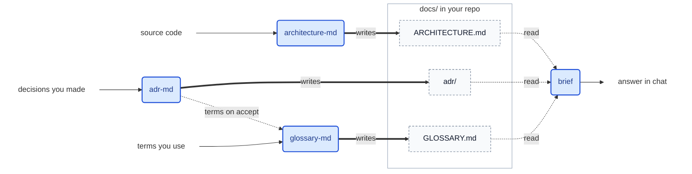

<div align="center">

# architecture-skills

**Four Claude Code skills that keep a codebase's architecture, decisions and vocabulary in the repo:<br/>written from the code, cited to the line, and brought up to date by a rerun.**

Claude Code plugin · Agent Skills format · MIT license · tested on Claude Code 2.1.325 with Opus 5.5 and Sonnet 5.5; Haiku 5.5 not supported

[How they connect](#how-the-skills-connect) · [Uses](#uses) · [Install](#install) · [Skills](#skills) · [Example](examples/image-resizer) · [Tests](evals/RESULTS.md)

</div>

Before you change a codebase, you need to know how its parts fit together, why they were built that way, and what the team means by words like "job" and "task". Some of that is in the code, spread across many files. The rest is in people's heads. These skills write it down in `docs/`, next to the code, where people review it in pull requests and agents can read it.

> [!IMPORTANT]
> The code is the source. Every fact in ARCHITECTURE.md cites `path:line`, every inference starts with *Inferred:*, and missing evidence is written down as a gap. Where a README or comment disagrees with the code, the doc follows the code and cites both.

## How the skills connect



Blue boxes are skills, dashed boxes are files in your repo. Thick arrows write; dotted arrows read or hand over. Beyond what is drawn, `architecture-md` links the key decisions it finds to their ADRs, `adr-md` checks a decision against the components it touches, and `brief` looks up an ADR for the reason behind a choice before it criticizes it. Existing files are used where they are: an `ARCHITECTURE.md` at the root, a `TERMINOLOGY.md`, ADRs in `docs/decisions/` or `adr/`.

## Uses

- **Talk to the codebase.** Ask how a flow works, why it was built that way, or what a term means, and get answers that cite the docs and the code.
- **Understand an existing project.** Map an inherited repo before changing it, then read the brief.
- **Review and harden.** The architecture doc covers auth, trust boundaries, secrets and a threat table. The brief weighs each risk against the recorded reason for the choice. The fixes you decide on become ADRs.
- **Plan work in other tools.** The docs are plain markdown, so an agent with a project-tracking plugin can turn the doc's gaps and open work, or the brief's risks, into issues.
- **Keep the repo as the source of truth.** Architecture, decisions and terms sit next to the code, go through pull requests, and record the commit they describe.

## Install

```
/plugin marketplace add cdvel/architecture-skills
/plugin install architecture-skills@architecture-skills
```

Then ask in plain words: "document the architecture of this repo", "record why we chose a queue over cron", "give me an architect's brief".

> [!TIP]
> To check the install, ask for a brief in a repo without docs. It should say no ARCHITECTURE.md was found and suggest `architecture-md`.

## Skills

Call a skill as `/architecture-skills:<name>`, or ask in plain words. Each skill owns one file and reads the others' when they exist, so it works alone or with the rest. The examples come from one run of all four on a 10-file test service; the full output is in [`examples/image-resizer`](examples/image-resizer).

### architecture-md

Reads the code and writes `docs/ARCHITECTURE.md`: summary and key decisions, C4 diagrams, components with a table of their files, data flows, infrastructure and CI/CD, security with trust boundaries and a threat table, configuration and data stores.

> [!NOTE]
> Each doc records the commit it describes. A rerun after code changes rewrites only the sections whose code changed and copies text between `<!-- keep -->` markers byte for byte. The skill only reads: it never runs builds, tests or the code.

<details>
<summary><b>Options</b></summary>

| Option | Effect |
|---|---|
| `path` | Folder to document; default the repo root |
| `--level exhaustive` | Adds every endpoint, dependency version and TODO; default `comprehensive` |
| `--sections a,b` | Writes or updates only these sections |
| `--output file` | Writes somewhere other than `docs/ARCHITECTURE.md` |
| `--stride` | One STRIDE threat table per trust boundary |
| `--verify` | Independent check of the finished doc before it is saved |

</details>

<details>
<summary><b>Example:</b> key decisions and threats from a generated ARCHITECTURE.md</summary>

<br/>

Reasons are quoted from code comments, or marked as not stated:

| Decision | Reason | Impact |
|---|---|---|
| Redis list `resize:jobs` as the job queue: `LPUSH` to enqueue, `BRPOP` to consume (api/app.py:48, worker/worker.py:33) | Not stated | FIFO order; *Inferred:* a job popped by a worker that then crashes is lost |
| Image bytes pass through a shared filesystem, not through the queue or the database (api/app.py:40-42, worker/worker.py:20, worker/worker.py:24) | Not stated | API and worker must see the same files at the same path; the worker retries "because the shared volume is sometimes slow to show new files" (worker/worker.py:46) |
| 10 MiB upload limit in the app, kept equal to a proxy limit (api/app.py:19) | "must match the proxy's body size limit" (api/app.py:19) | The limit is set in two places, one of them outside the repo |

Threats are checked against each trust boundary:

| Threat | Where it applies | Mitigation | Status | Gap |
|---|---|---|---|---|
| Timing attack on the token | `require_token()` | None | not mitigated | Non-constant-time `!=` (api/app.py:26); TODO at api/app.py:25 |
| Confused deputy and privilege escalation | Job reads; worker acting on queue messages | The API builds job ids and paths itself (api/app.py:39-40) | partial | No per-client authorization (api/app.py:52-61). *Inferred:* anyone who can write to Redis chooses which file the worker opens and, through `job_id`, where it writes (worker/worker.py:20, worker/worker.py:24) |
| Internal path disclosure | `GET /v1/images/<job_id>` responses | None | not mitigated | Absolute server paths returned to clients (api/app.py:61, worker/worker.py:24) |

Full document: [`examples/image-resizer/docs/ARCHITECTURE.md`](examples/image-resizer/docs/ARCHITECTURE.md)

</details>

### adr-md

Records one decision per file in `docs/adr/`, with the options considered and the consequences, and keeps statuses, supersession links and the index consistent. It pushes back on a decision with a single option or one not worth an ADR. Accepted records are locked: a changed decision becomes a new record that supersedes the old one.

<details>
<summary><b>Commands</b></summary>

| Command | Effect |
|---|---|
| `new "<topic>"` | Records a decision, asking first for anything missing |
| `propose <n>` | Draft to Proposed |
| `accept <n>` | Proposed to Accepted; marks the records it replaces Superseded; hands its terms to `glossary-md` |
| `supersede <n>` | New record that replaces ADR n, fully or in part |
| `deprecate <n>` | Accepted to Deprecated, with a reason |
| `amend <n>` | Fixes typos, links and formatting in a locked record |
| `index` | Rebuilds `docs/adr/README.md` |

</details>

<details>
<summary><b>Example:</b> an accepted ADR, from three options given in one request</summary>

```markdown
---
id: ADR-0001
title: Resize uploaded images in a separate worker fed by a Redis list
status: Accepted
...
terms:
  - {term: Resize job, definition: "One upload's request for thumbnails, recorded as a row in the jobs table and queued as a message on the job queue."}
  - {term: Job queue, definition: "The Redis list resize:jobs, which the API pushes resize jobs onto and the worker pops them from."}
  ...
---
...
### External image CDN that resizes on the fly

Originals are stored once and an image CDN produces each size when it is first requested, then caches it. Its supporters point out that there is no worker, queue, job table or thumbnail storage to run, that new sizes need no reprocessing of existing images, and that the vendor carries the work of decoding untrusted images.

Rejected because it adds a paid dependency and sends our images to infrastructure we do not run.

## Decision

We will resize uploaded images in a separate worker process, not inside the upload request: the API stores the original, records a `queued` row in the PostgreSQL `jobs` table, pushes the job onto the Redis list `resize:jobs` and returns `202` with the job id, and the worker pops jobs from that list, writes the thumbnails and records the result on the job row, which clients poll.

## Consequences
...
### Negative

- A plain Redis list delivers each job at most once. `BRPOP` removes the message before work starts and nothing puts it back (worker/worker.py:33), so a job held by a worker that crashes is lost and its row stays `queued`. Retries and dead-lettering are left to the worker.
...
```

Full record: [`examples/image-resizer/docs/adr/0001-resize-images-in-a-separate-worker.md`](examples/image-resizer/docs/adr/0001-resize-images-in-a-separate-worker.md)

</details>

### glossary-md

Keeps `docs/GLOSSARY.md` as one sorted table: each term with one definition and its source (an ADR, a standard or a team convention). It is the only skill that writes the glossary.

<details>
<summary><b>Commands</b></summary>

| Command | Effect |
|---|---|
| `add "<term>"` | Adds or rewords a term, drafting a definition from how the repo uses it if none is given |
| `backfill` | Adds the terms of accepted ADRs, record by record |
| `reconcile` | Finds duplicates, unused terms, broken ADR links and format problems, then applies the fixes you approve |

</details>

<details>
<summary><b>Example:</b> the glossary after ADR-0001 was accepted</summary>

```markdown
| Term | Definition | Source |
|---|---|---|
| Job queue | The Redis list resize:jobs, which the API pushes resize jobs onto and the worker pops them from. | [ADR-0001](adr/0001-resize-images-in-a-separate-worker.md) |
| Resize job | One upload's request for thumbnails, recorded as a row in the jobs table and queued as a message on the job queue. | [ADR-0001](adr/0001-resize-images-in-a-separate-worker.md) |
| Worker | The separate process in worker/worker.py that pops resize jobs from the job queue and writes thumbnails, as opposed to gunicorn's request-serving worker processes. | [ADR-0001](adr/0001-resize-images-in-a-separate-worker.md) |
```

Full file: [`examples/image-resizer/docs/GLOSSARY.md`](examples/image-resizer/docs/GLOSSARY.md)

</details>

### brief

Answers in chat from `ARCHITECTURE.md`, the ADRs and the glossary: a verdict, an ASCII diagram, the main parts, one request traced end to end, files to start reading, and an assessment marked as opinion. It says how many commits behind HEAD the doc is, and writes nothing. It takes an optional path to the doc; ask for a short brief to get only the verdict, diagram and assessment.

<details>
<summary><b>Example:</b> parts of a brief, as it appears in chat</summary>

````markdown
image-resizer is a small Python service that takes image uploads over HTTP and turns each one into 128x128 and 512x512 PNG thumbnails in the background. ... In my view the core split between API and worker is sound and well reasoned for a small team, but the rest is unfinished: jobs can be lost or stuck as `queued` without anyone noticing, and the repo doesn't show how the service is deployed, migrated or monitored, or how clients get their thumbnails.

## Source

`docs/ARCHITECTURE.md` · architecture-md 0.1.0 · generated 2026-11-14 · commit c996f9c · 1 commit behind HEAD. That one commit only added ADR-0001 and the glossary, so the code it describes hasn't changed. The doc still says the repo has no ADR register, though. I'd regenerate it with architecture-md so it picks them up.

## Picture

```
        +-------------------------------------------------------+
        | api: Flask on gunicorn, 2 sync processes              |
        +-------------------------------------------------------+
             | SQL INSERT,        | LPUSH              | write
             | SELECT            | job message        | <job_id>.orig
             v                   v                    v
      +--------------+   +---------------+   +-----------------+
      | PostgreSQL   |   | Redis list    |   | shared volume   |
      | table jobs   |   | resize:jobs   |   | /data/uploads   |
      |              |   | (job queue)   |   | /data/outputs   |
      +--------------+   +---------------+   +-----------------+
             ^                   | BRPOP              ^ read .orig,
             | SQL UPDATE        v                    | write 2 PNGs
        +-------------------------------------------------------+
        | worker: Pillow resize, one job at a time              |
        +-------------------------------------------------------+
```
...
## Assessment (opinion)

**Strengths**
- The separate worker is the right call here, and the reason is recorded [ADR-0001]. With only two synchronous gunicorn processes per container, resizing inside the request would stall the API. ...

**Risks**
- Untrusted images are decoded with no format allowlist and no pixel limit, in a container that (inferred) runs as root [Security, Infrastructure and deployment]. No reason is recorded.
...
````

Full reply: [`examples/image-resizer/BRIEF.md`](examples/image-resizer/BRIEF.md)

</details>

## Tests

`evals/` has 43 cases for `claude plugin eval`: 27 check that each skill loads for its own requests and not for others, and 16 check behavior on small test repos. Results of the last run: [`evals/RESULTS.md`](evals/RESULTS.md).

## Background

- [ARCHITECTURE.md](https://matklad.github.io/2021/02/06/ARCHITECTURE.md.html), matklad
- [Documenting architecture decisions](https://www.cognitect.com/blog/2011/11/15/documenting-architecture-decisions), Michael Nygard
- [Ubiquitous language](https://martinfowler.com/bliki/UbiquitousLanguage.html), Eric Evans's term, summarized by Martin Fowler

## License

MIT
