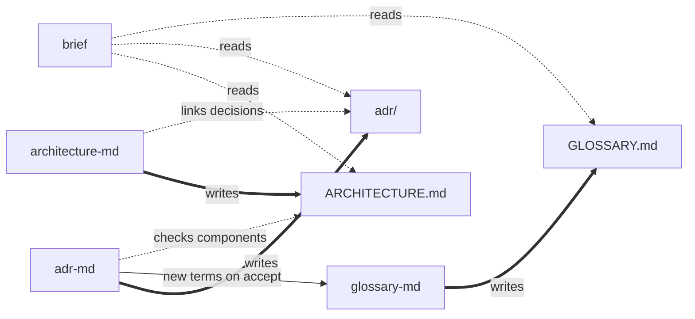

# architecture-skills

**Four Claude Code skills that keep a codebase's architecture, decisions and vocabulary in the repo: written from the code, cited to the line, and brought up to date by a rerun.**

Claude Code plugin · Agent Skills format · MIT license · tested on Claude Code 2.1.325 with Opus 5.5 and Sonnet 5.5; Haiku 5.5 not supported

```
/plugin marketplace add cdvel/architecture-skills
/plugin install architecture-skills@architecture-skills
```

Then ask in plain words: "document the architecture of this repo", "record why we chose a queue over cron", "give me an architect's brief".

## Motivation

Some of what you need to change a codebase safely is not in any one file:

- How a request gets from the API to the database. The agent works it out again every session by reading the same modules.
- Why the queue replaced the cron job. Nobody wrote it down, so a later refactor brings the cron job back.
- Whether "job", "task" and "run" are one thing or three, when the code uses all of them.
- Where the README says one thing and the code does another.

`architecture-md` writes the first down from the code and flags the last as a conflict. `adr-md` records the second, and `glossary-md` keeps the third. `brief` reads all of it back to you in chat, with an opinion.

## What lands in your repo

```
docs/
├── ARCHITECTURE.md    what the system is: parts, flows, security, config   architecture-md
├── adr/               why it is built that way, one decision per file      adr-md
│   ├── README.md
│   └── 0001-capture-payments-in-worker.md
└── GLOSSARY.md        what the project's terms mean                        glossary-md
```

`brief` writes nothing. Existing files are used where they are: an `ARCHITECTURE.md` at the root, a `TERMINOLOGY.md`, ADRs in `docs/decisions/` or `adr/`.

## How the skills connect

Each skill owns one file and reads the others' when they exist, so it works alone or with the rest.



Thick arrows write, dotted arrows read. `architecture-md` links the key decisions it finds to their ADRs, `adr-md` checks a decision against the components it touches, and `brief` looks up an ADR for the reason behind a choice before it criticizes it.

## Output

An excerpt from the ARCHITECTURE.md that `architecture-md` wrote in an eval run on a 10-file test service (an image upload API and a resize worker). Reasons come from code comments, the guess is marked, and the missing deployment becomes a question:

> | Decision | Reason | Impact |
> |---|---|---|
> | Asynchronous processing via a Redis list (`resize:jobs`) | *Inferred:* keep the HTTP request short while resizing runs elsewhere; rests on the 202 response (`api/app.py:49`) and the worker module docstring (`worker/worker.py:1`) | Clients must poll; a job popped by a worker that then crashes is lost |
> | Upload cap of 10 MiB in code | "must match the proxy's body size limit" (`api/app.py:19`) | A reverse proxy exists in front of the API but is not in this repo |
> | Retry with exponential backoff on `OSError` | "the shared volume is sometimes slow to show new files" (`worker/worker.py:46`) | Up to about 6 s extra per bad job (2 s + 4 s) before it is marked `failed` |
>
> **Gap:** No staging or production environment is defined in the repo (no compose file, manifests or IaC (infrastructure as code)).
> **Question:** Where does the pushed image run, and what deploys it?

`brief` answers in chat with a verdict, an ASCII diagram, a table of parts, one request traced end to end, files to start reading, and an assessment marked as opinion. From a run on a second test repo, a small shop backend:

> In my view it's a sensible, small design with one good key decision (capturing payments off the request path). It isn't ready for real money yet: a retried capture can charge a customer twice, and nothing logs or alerts when a capture fails.
>
> - **Double charge on retry.** A retry doesn't send an idempotency key (an id that lets the provider ignore a repeated request). The code's own FIXME says this "can charge twice". I'd fix this first.
> - **Stateless cookie sessions.** The recorded reason is "no session store to run", which is valid. The cost is that a stolen cookie can't be revoked for 7 days, and sign-in has no rate limit. I think that trade-off is fine for now, but I'd add the rate limit.

## Uses

- **Talk to the codebase.** Ask how a flow works, why it was built that way, or what a term means, and get answers that cite the docs and the code.
- **Understand an existing project.** Map an inherited repo before changing it, then read the brief.
- **Review and harden.** The architecture doc covers auth, trust boundaries, secrets and a threat table (`--stride` for one STRIDE table per boundary). The brief weighs each risk against the recorded reason for the choice. The fixes you decide on become ADRs.
- **Plan work in other tools.** The docs are plain markdown, so an agent with a project-tracking plugin can turn the doc's gaps and open work, or the brief's risks, into issues.
- **Keep the repo as the source of truth.** Architecture, decisions and terms sit next to the code, go through pull requests, and record the commit they describe.

## Accuracy

- Every fact in ARCHITECTURE.md cites `path:line`, every inference starts with *Inferred:*, and missing evidence is a stated gap. Where a README or comment disagrees with the code, the doc follows the code and cites both.
- Citations go stale as code moves, so each doc records its commit. `brief` says how many commits behind HEAD the doc is. A rerun of `architecture-md` rewrites only the sections whose code changed and copies text between `<!-- keep -->` markers byte for byte.
- Accepted ADRs are locked. A changed decision is a new record that supersedes the old one, which stays as it was.
- `architecture-md` only reads. It never runs builds, tests or the code.

## Usage

```
/architecture-skills:architecture-md                     # write or update docs/ARCHITECTURE.md
/architecture-skills:architecture-md --stride            # with a STRIDE threat table per trust boundary
/architecture-skills:brief                               # architect's brief in chat
/architecture-skills:adr-md new "queue instead of cron"  # record a decision
/architecture-skills:adr-md accept 3                     # accept ADR-0003; its terms go to the glossary
/architecture-skills:glossary-md backfill                # add terms from accepted ADRs
```

To check the install, run `/architecture-skills:brief` in a repo without docs: it should say no ARCHITECTURE.md was found and suggest `architecture-md`. Options and rules are in each `skills/<name>/SKILL.md`.

## Tests

`evals/` has 43 cases for `claude plugin eval`. 27 check that each skill fires for its own requests and stays out of others. 16 build a small git repo, send one request, and check the files and the reply: for example, that an accepted ADR can't be rewritten, that a one-option decision gets pushed back, that a rerun keeps unchanged sections byte for byte, and that `brief` reports staleness in commits without reading source code.

In the eval run excerpted above, all 82 `path:line` citations pointed at real lines. The four skill descriptions add about 1.2k tokens to every session; an invoked skill loads 1.7k to 2.6k more, plus reference files only for the step in use.

## Limits

- Tested in Claude Code, on small test repos. On a large repo, `architecture-md` shows a time estimate and asks before exploring.
- Haiku 5.5 skips `adr-md`'s checks and edits accepted records directly.
- Reading is static, so behavior that only shows at runtime becomes a gap.
- `--stride` and `--verify` have no eval cases yet.
- Not for API reference docs, README edits or a single diagram.

Background: [ARCHITECTURE.md](https://matklad.github.io/2021/02/06/ARCHITECTURE.md.html) (matklad), [architecture decision records](https://www.cognitect.com/blog/2011/11/15/documenting-architecture-decisions) (Michael Nygard), [ubiquitous language](https://martinfowler.com/bliki/UbiquitousLanguage.html) (Eric Evans, summarized by Martin Fowler).

## License

MIT
