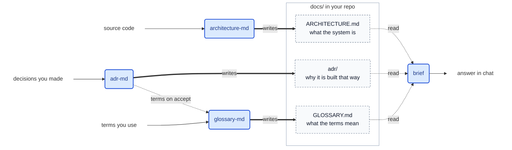

# architecture-skills

**Four Claude Code skills that keep a codebase's architecture, decisions and vocabulary in the repo: written from the code, cited to the line, and brought up to date by a rerun.**

Claude Code plugin · Agent Skills format · MIT license · tested on Claude Code 2.1.325 with Opus 5.5 and Sonnet 5.5; Haiku 5.5 not supported

```
/plugin marketplace add cdvel/architecture-skills
/plugin install architecture-skills@architecture-skills
```

Then ask in plain words: "document the architecture of this repo", "record why we chose a queue over cron", "give me an architect's brief". To check the install, ask for a brief in a repo without docs: it should say no ARCHITECTURE.md was found and suggest `architecture-md`.

Some of what you need to change a codebase safely isn't in any one file: how a request gets from the API to the database, why the queue replaced the cron job, whether "job" and "task" are one thing or two, where the README and the code disagree. These skills write it into `docs/`, next to the code, where people review it in pull requests and any agent can read it.

## Skills

Call a skill as `/architecture-skills:<name>` with the options below, or ask in plain words. Each skill owns one file and reads the others' when they exist, so it works alone or with the rest.

### architecture-md

Reads the code and writes `docs/ARCHITECTURE.md`: summary and key decisions, C4 diagrams, components with a table of their files, data flows, infrastructure and CI/CD, security with a threat table, configuration and data stores. A rerun after code changes rewrites only the sections whose code changed.

| Option | Effect |
|---|---|
| `path` | Folder to document; default the repo root |
| `--level exhaustive` | Adds every endpoint, dependency version and TODO; default `comprehensive` |
| `--sections a,b` | Writes or updates only these sections |
| `--output file` | Writes somewhere other than `docs/ARCHITECTURE.md` |
| `--stride` | One STRIDE threat table per trust boundary |
| `--verify` | Independent check of the finished doc before it is saved |

### adr-md

Records one decision per file in `docs/adr/`, with the options considered and the consequences, and keeps statuses, supersession links and the index consistent. It pushes back on a decision with a single option or one not worth an ADR, and refuses content edits to accepted records.

| Command | Effect |
|---|---|
| `new "<topic>"` | Records a decision, asking first for anything missing |
| `propose <n>` | Draft to Proposed |
| `accept <n>` | Proposed to Accepted; marks the records it replaces Superseded; hands its terms to `glossary-md` |
| `supersede <n>` | New record that replaces ADR n, fully or in part |
| `deprecate <n>` | Accepted to Deprecated, with a reason |
| `amend <n>` | Fixes typos, links and formatting in a locked record |
| `index` | Rebuilds `docs/adr/README.md` |

### glossary-md

Keeps `docs/GLOSSARY.md` as one sorted table: each term with one definition and its source (an ADR, a standard or a team convention). It is the only skill that writes the glossary.

| Command | Effect |
|---|---|
| `add "<term>"` | Adds or rewords a term, drafting a definition from how the repo uses it if none is given |
| `backfill` | Adds the terms of accepted ADRs, record by record |
| `reconcile` | Finds duplicates, unused terms, broken ADR links and format problems, then applies the fixes you approve |

### brief

Answers in chat from `ARCHITECTURE.md`, the ADRs and the glossary: a verdict, an ASCII diagram, the main parts, one request traced end to end, files to start reading, and an assessment marked as opinion. It says how many commits behind HEAD the doc is, and writes nothing. It takes an optional path to the doc; ask for a short brief to get only the verdict, diagram and assessment.

## How the skills connect



Blue boxes are skills, dashed boxes are files in your repo. Thick arrows write; dotted arrows read or hand over. Beyond what is drawn, `architecture-md` links the key decisions it finds to their ADRs, `adr-md` checks a decision against the components it touches, and `brief` looks up an ADR for the reason behind a choice before it criticizes it. Existing files are used where they are: an `ARCHITECTURE.md` at the root, a `TERMINOLOGY.md`, ADRs in `docs/decisions/` or `adr/`.

## Output

An excerpt from the ARCHITECTURE.md that `architecture-md` wrote in an eval run on a 10-file test service (an image upload API and a resize worker). Reasons come from code comments, the guess is marked, and the missing deployment becomes a question:

> | Decision | Reason | Impact |
> |---|---|---|
> | Asynchronous processing via a Redis list (`resize:jobs`) | *Inferred:* keep the HTTP request short while resizing runs elsewhere; rests on the 202 response (`api/app.py:49`) and the worker module docstring (`worker/worker.py:1`) | Clients must poll; a job popped by a worker that then crashes is lost |
> | Upload cap of 10 MiB in code | "must match the proxy's body size limit" (`api/app.py:19`) | A reverse proxy exists in front of the API but is not in this repo |
> | Retry with exponential backoff on `OSError` | "the shared volume is sometimes slow to show new files" (`worker/worker.py:46`) | Up to about 6 s extra per bad job (2 s + 4 s) before it is marked `failed` |
>
> **Gap:** No staging or production environment is defined in the repo (no compose file, manifests or IaC (infrastructure as code)).
> **Question:** Where does the pushed image run, and what deploys it?

From a `brief` run on a second test repo, a small shop backend:

> In my view it's a sensible, small design with one good key decision (capturing payments off the request path). It isn't ready for real money yet: a retried capture can charge a customer twice, and nothing logs or alerts when a capture fails.
>
> - **Double charge on retry.** A retry doesn't send an idempotency key (an id that lets the provider ignore a repeated request). The code's own FIXME says this "can charge twice". I'd fix this first.
> - **Stateless cookie sessions.** The recorded reason is "no session store to run", which is valid. The cost is that a stolen cookie can't be revoked for 7 days, and sign-in has no rate limit. I think that trade-off is fine for now, but I'd add the rate limit.

## Uses

- **Talk to the codebase.** Ask how a flow works, why it was built that way, or what a term means, and get answers that cite the docs and the code.
- **Understand an existing project.** Map an inherited repo before changing it, then read the brief.
- **Review and harden.** The architecture doc covers auth, trust boundaries, secrets and a threat table. The brief weighs each risk against the recorded reason for the choice. The fixes you decide on become ADRs.
- **Plan work in other tools.** The docs are plain markdown, so an agent with a project-tracking plugin can turn the doc's gaps and open work, or the brief's risks, into issues.
- **Keep the repo as the source of truth.** Architecture, decisions and terms sit next to the code, go through pull requests, and record the commit they describe.

## Accuracy

- Every fact in ARCHITECTURE.md cites `path:line`, every inference starts with *Inferred:*, and missing evidence is a stated gap. Where a README or comment disagrees with the code, the doc follows the code and cites both.
- Citations go stale as code moves, so each doc records its commit, and `brief` says how far behind HEAD it is. Rerunning `architecture-md` brings it up to date and copies text between `<!-- keep -->` markers byte for byte.
- `architecture-md` only reads. It never runs builds, tests or the code.

## Tests

`evals/` has 43 cases for `claude plugin eval`: 27 check that each skill loads for its own requests and not for others, and 16 check behavior on small test repos. Results of the last run: [evals/RESULTS.md](evals/RESULTS.md).

## Background

- [ARCHITECTURE.md](https://matklad.github.io/2021/02/06/ARCHITECTURE.md.html), matklad
- [Documenting architecture decisions](https://www.cognitect.com/blog/2011/11/15/documenting-architecture-decisions), Michael Nygard
- [Ubiquitous language](https://martinfowler.com/bliki/UbiquitousLanguage.html), Eric Evans's term, summarized by Martin Fowler

## License

MIT
